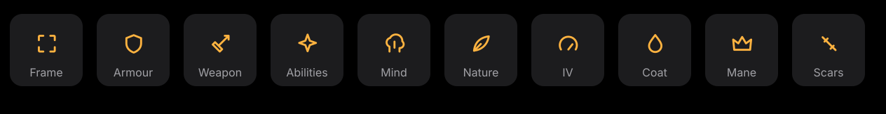
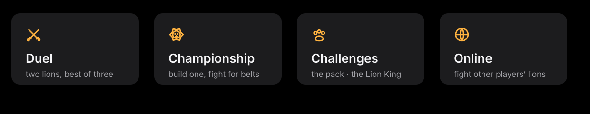

<p align="center">
  
</p>

<p align="center">
  
  
  
</p>

---

## You don't control the lion

You build it. Then you watch.

Lion Sim is an arena fighting game where the lions fight on their own. You pick the frame, the weapon, the abilities and the mind. Once the gate opens, it's all them. They chase, kite, dodge and hit their big moves when it counts, and they win or lose on their own.

You're the owner, not the player.

**Play it at [gatsi.github.io](https://gatsi.github.io).** That's it. It works on your phone too, and you can add it to your home screen. It's one HTML file, so you can also download `index.html` and open it in any browser.

---

## Build a lion

<p align="center">
  
</p>

- **Frame.** Tiny cubs are fast and fragile. Titans are slow and hit like a truck.
- **Weapon.** 14 of them, from claws and spears to bows, fireballs and a Sunbeam. Long reach slows you down.
- **Abilities.** Pick two: dash, blink, roar, heal, shield, frenzy, go invisible, call a cub, and more.
- **Mind.** Berserker, Duelist, Kiter, Trickster or Adaptive. It changes how the lion fights, not how hard it hits.
- **Personality.** Every lion carries two of 23 traits. *Grudge* gets angrier with every scar. *Showman* fights better when the crowd is loud. *Lucky* cheats death more often.
- **Looks.** 12 coats, 8 manes, 8 tails. Pure style.

Hit **Roll** anywhere to get a random lion in one tap.

---

## Modes

<p align="center">
  
</p>

### ⚔️ Duel
Two lions, best of three. Build both, roll both, or paste in a friend's lion and settle it.

Switch to **2v2** for tag-team fights: two teams of two, and a round only ends when both lions on one side are down. Teammates never hit each other.

### 🏆 Championship
Build your own lion and send it through five-fight championships. Win all five and it earns a **gold belt** and a medallion that makes it stronger. Once it's yours, it's locked in. No tweaks.

Losing hurts. Every loss it survives leaves a **scar** you'll see on it forever. And every time it loses, there's a **1 in 5 chance it dies**. Then it goes up on the Hall of Fame and you start again. Fallen and retired lions aren't lost: tap any of them on the wall to see the lion, its card, its full summary and its code, so you can bring it back in a duel.

Every opponent has a fight record of its own. Your first ones are rookies like you, sitting on records like 1–0 or 2–3. The deeper you go, the more fights they've had and the more they've won. Win a belt and the last opponent of every championship after that is a belt holder too.

Lions **remember you**. One that beats you and lets you live becomes a **rival**, and so might one you only just scraped past. Rivals come back in later championships, a little harder each time, and the den keeps the score between you. A lion that **kills** yours becomes your **nemesis**: it outlives your lion and comes back for the next one, as the final, with red eyes and a mark for every lion it's taken. Beat it and it's **avenged** (40 gold and 3 skulls).

Every win also has a **35% chance of a training opportunity**: pick health, damage, speed, swing or armour and your lion gets a little better at it, for good. Belts bring **medallions**, bigger boosts with their own emblems. You can also **load any lion code** straight into the den.

Your lion's gold and skulls sit at the top of the screen (tap them to go straight to the shops), and the den shows who's next at a glance. Every championship win earns your lion **gold**, and harder fights pay more: 5 to 15 to start with, plus 6 for every belt it holds and 3 for every bout deeper into the championship. Spend it in the **Lion Store**, run by a red lion in a gold monocle: a new coat, a potion that rerolls one personality trait, a whole new weapon, an **Upgrade Token** (100 gold) for a guaranteed training session, or a **Name Plaque** (60 gold) to rename it.

Next door, the **Blacksmith** (an old grey lion covered in soot) puts a finish on your lion's weapon: **Bronze, Obsidian, then Gilded** (50, 150 and 250 gold), each worth +2% damage and a glint of its colour on every swing and shot. The finish belongs to the weapon, so swap weapons and it's gone (you'll get a warning first). He also sells **Reforge Armour** (50 gold) to change armour, and two swords your lion wears across its back: the **Steel Sword** (200 gold, +5% damage) and the **Gold Sword** (1,000 gold, +10% damage). Or an axe in the same slot: the **Silver Axe** (200 gold, +5% swing rate) and the **Gold Axe** (1,000 gold, +15% swing rate). Or a small round shield: the **Silver Shield** (200 gold, +5% health) and the **Gold Shield** (1,000 gold, +15% health).

**The Cosmetic Lion** keeps a war tent at the den: paint, bone, steel, sashes, laurels, earrings, a party hat, even a **DandeLion** (5 gold, a dandelion behind one ear). Looks only, none of it changes a fight. For the rich there are **gem eyes**: a Sapphire, Emerald or Ruby set in whichever eye you pick, 1,000 gold each. **Cosmetic Shears** snip anything off for good. **Gift Parcels** (15 gold) let you wrap an item, gold or skulls with a note and send it to any player on the leaderboard.

**Crates.** Mystery Crates open on a spinning reel that slows down and stops on what you got, with rarity colours from Common to Legendary. Your lion also gets a **free daily crate**: claim it from the den once a day.

Under the stands, the **Hyena Fence** buys skulls (1 skull → 25 gold), sells **Mystery Crates** (45 gold: gold, skulls, anything from any shop, and once in a while a soul), and keeps three under-the-counter **deals**, 5 to 10 gold off, that change after every bout. Whatever you buy goes into the lion's own **inventory**, and you use it from there whenever you like. Beat a lion in a championship and there's a 40% chance your lion takes its **skull** home. Skulls stack, and they're the only thing the **Mystic Lion** next door will take: 7 skulls buys a **Divine Soul** (eyes that glow white like an angel's and a holy light around it) or a **Demonic Soul** (red eyes and hellfire). Either one gives +10% to every stat. A lion can only carry one soul at a time. **Soul Cleanse** (2 skulls) washes a soul away, and a **Blood Pact** (5 skulls) rerolls your lion's IV, for better or worse. For 3 skulls it also sells **Heavenly Protection**: if your lion would die in a championship, the blessing burns away instead and it walks out alive. The gold and the bag belong to that lion. When it's gone, so are they.

**Questlines.** Two things in the den can't be bought outright:
- **Lionsteel (Lv4).** Get your weapon to Gilded and the Blacksmith has a job for you: beat **100 lions** (championship bouts, grudges, bosses and online fights all count), then bring **25 skulls and 1,000 gold**. +12% damage and a blood-red edge.
- **Ancient Steel (Lv5).** Past Lionsteel: beat the Ancient Lion 10 times, the Twin Kings 5, the Lion King 10 and the Gatekeeper 5, then pay **1,000 gold and 20 skulls**. +20% damage and a starlight-blue edge.
- **The Void Soul.** The one soul the Mystic Lion won't sell. It upgrades a Divine or Demonic Soul, and only a full-grown one: souls level up at the Mystic for 10 skulls a level (Lv1 +10%, Lv2 +12%, Lv3 +14%), with a bigger aura each time, and the Void only takes a Lv3 soul. Win **10 championships**, then bring **100 skulls**. A black sun rises behind your lion and it gets **+15%** to every stat.
- **The Ancient Lion Soul.** Beat the Ancient Lion 10 times and the Mystic Lion sells it for **15 skulls**. No stat boost: instead, three stars fall on your lion's enemies every 7 seconds. It is its own soul, bound from the bag like a Divine or Demonic one.
- **The Godslayer Blade.** Beat Cal the Shagon and the Blacksmith tells you his sword broke in three. Beat Cal, the Twin Kings and the Ancient Lion once more each for the fragments. Carry them back over the bridge and the **God Lion** they were pulled out of wakes up. Beat it, then pay **1,000 gold and 10 skulls**. A glowing sword for the back, +15% damage.

The Blacksmith and Mystic Lion doors in the den show how far along each one is.

**The Bookie.** A green lion in a flat cap and a pencil behind his ear runs fights between two other lions. You get a look at both (record, frame, weapon, mind and how big they are) and his odds on the chalkboard, back one, and watch it play out. Win and you get your stake times the odds; lose and he keeps it. Bigger lions are usually the favourites, and the odds lean very slightly your way, so it's a way to make money, slowly: he only runs **three fights between each of your championship bouts**, and stakes are capped at 25 gold (+15 per belt, up to 100). You can also watch for free. Your lion keeps a tally of how its betting is going.

**Events.** After a win, with another bout still to come, there's a **35% chance something happens** outside the den. The den shows it, the bottom button turns into **An event awaits**, and you can't fight on until you've gone and seen it. Each one plays out as a little scene with a choice. There are twenty-one:
- **The Royal Lion** wants a bet on your next fight: win and he **doubles your gold**, lose and he **takes all of it**.
- **The Mystic Lion** offers **two skulls** if your lion starts its next bout on **75% health**.
- **The Lion Store owner** wants your lion as the face of his shop: **30% off for 5 bouts**.
- **The crate in the trees.** A free item... then **five hyenas** come out of the bushes for it.
- **Old Lion's Hut.** 50 gold and he'll teach you one stat, your pick.
- **Robbed!** Pay them 10% of your gold, or fight, with a 40% chance of a cut eye.
- **A Cub by the Road.** Pay the healer, and it may not forget you.
- **The Wandering Merchant.** One odd deal, take it or leave it.
- **A Grudge on the Road.** A rival waiting by a torch. Win gold, lose gold, nobody dies.
- **The Carrion Feast.** Take a dead champion's claws (+1 skull, +10% damage, maybe a curse) or pay your respects (+10% health).
- **The Fix.** Throw your next fight for gold, or refuse and fight the Bookie's heavy.
- **The Exiled King.** Free the Lion King's chained brother for training, or turn him in for gold. The King remembers.
- **The Clan War.** Side with the Bone clan or the Ash clan. The other one will want revenge.
- **The Mystic's Mirror.** Fight your own shadow for a skull.
- **Scavenger Night.** Search the arena floor for armour, an edge or gold. Hyenas may come for it.
- **The Twin Statue.** Pray to Kaldur or Sevrin, leave them a skull, or steal their gold eyes.
- **The Princes' Yard.** The Black Princes are training. Peek through the wall and learn a stat for free, but there's a **40% chance one catches you**, and then it's one on one in his yard.
- **The Blacksmith's Apprentice.** He'll sharpen your weapon for free. 70% it works (+5% damage for 3 bouts), 30% he ruins the finish.
- **Vex's Game.** Three cups: skulls, gold, or a curse. Pick one.
- **The Bookie's Debt.** Guard him from five hyenas and he pays in a **free bet**: top stake, double odds.
- **The Night Market.** Three random items at half price, for gold, gone by morning.
- **The Fisherman.** 50 gold a cast, up to three casts. The river gives back one random item from any shop: often something small, sometimes a sword, a soul or a gem eye. Never a boss sash.

Say no to any of them and nothing changes. Anything still waiting to be settled shows in the den.

### 🐾 Challenges
Seven of them, and each boss only opens once your lion has beaten the one before.

1. **The Pack.** Survive wave after wave of dogs and hyenas in the Hyena Den, with the walls closing in. It's for your best wave and kill count, not gold.
2. **Old Lion.** Your tutor, out of retirement for one last fight. Beat him and you can visit him at home instead: fight him again, or ask him things (how upgrades work, who the Twin Kings are, who the Mystic Lion is).
3. **The Lion King.** In his own arena, the Fallen Hall. First his three sons, the **Black Princes**, in plate like their father. Then him, huge and in black armour, with whatever health you have left.
4. **The Ancient Lion.** He sleeps in an orb in the Star Sanctum. Your lion walks up to it and you choose: summon him, or walk away (and be remembered as afraid). Say yes and the stars fall into the orb until it breaks. In the fight, get close and he blasts you with a gold nova; stay back and the sky rains stars and meteors.
5. **The Gatekeeper.** Plated head to tail in front of his Iron Gate. Crack his iron with heavy hits before he bleeds, while the spiked walls close in.
6. **The Twin Kings.** Kaldur and Sevrin, on the Twin Throne. First their four children: Brann swings, Ysra shoots, Morwen casts and Vex tricks. Then their fathers.
7. **The God Slayer.** Cal the Shagon. A god lion walked into the world, and he was blessed with a sword and killed it. Old Lion waits on the stone bridge to the Godfall and tells you not to go: cross, or stand down. On the other side his faithful kneel around him: interrupt the ceremony and he turns round and tells you who he is. Then it's a fight with a Sunbeam, a golden cut across the floor, and hyenas he whistles up (mostly for show). Beat him for the **Godslayer's Sash**.
8. **Boss Rush.** Unlocked by beating Cal. All six bosses in order, back to back, with no stops: it runs by itself, and your lion keeps whatever health it has left from one to the next. Clear all six and it goes straight into the next lap on full health with every boss 10% stronger in health, damage, speed and swing rate, then 20%, and so on until your lion falls. Only your longest run is recorded.

Boss fights are long, grand affairs with huge health bars and big moments along the way. Every time you beat a boss it comes back **10% stronger**, and it shows you by how much before the fight. Beaten bosses show as trophies on your lion's card. Bring up to two friends to any of them.

### 🌐 Online
Make an account and your lion can fight other players' lions in the **Online Pit**. Every lion starts on a rating of 1,000 that goes up and down with every fight, and the best sit on the **leaderboard**. At the top of the page is **the Yard**, where the top ten lions walk about with their player's name over their heads. Number one wears a crown, and a card under the Yard shows how long they have held the top, their kills since they last lost, and the **bounty** on their head: 1,000 gold, growing 500 an hour up to 100,000, paid to whoever beats them.

---

## Lion codes

Every lion fits into one line of text:

```
LION1-R29sZG1hbmV8NHwyfDN8MTEuNXwzfDAuMnwyLjExLjE0fDF8N3wxfDEyODQuNjE3fDEyLjE4
```

Copy it, save it as a `.txt`, send it to a mate. It carries everything: the build, the looks, the scars and the belts. Paste a champion into a duel and the game asks whether it keeps its medallions or comes in fresh.

Belts can only be won. The Editor always loads lions without them.

---

## Little things

- Every fight opens at the gates. The portcullis lifts, each lion walks out to its mark and its name and record are called out in its own colours. Tap to skip.
- Every weapon looks like what it is: claws rake, spears thrust, arrows fly fletched, boulders tumble and crack the floor, fireballs leave scorch marks, venom pools, Storm Bolt forks and the Sunbeam burns.
- A crowd of lions fills the stands and reacts to every big hit.
- An original soundtrack, all generated live: a brooding pre-battle theme while your lion waits at the gate, war drums in the fights, something heavier for the bosses... and one very sad song. The ⋯ menu at the top cycles sound + music, sound only, or off.
- Every lion is drawn live, so scars, belts, manes and tails show up everywhere, including in the fights.
- Open any lion's **Summary** to get its **lion card**: a trading-card picture with the lion, its badges, traits, stats, loadout and record. Copy it, save it or share it straight to your friends.
- Every mode lives in the bar along the bottom, with a free **Editor** at the end for building anything you want, just for fun.
- New here? Tap **?** and Old Lion will walk you through everything. He's been around a while.
- The **What's New** tab lists every update, with older ones further down.
- Your progress saves in the browser (and to your account if you sign in), so your lion and gold are still there next time.

---

<p align="center">
  
</p>

<p align="center">
  <sub>There is one name you should not give a lion.</sub>
</p>
