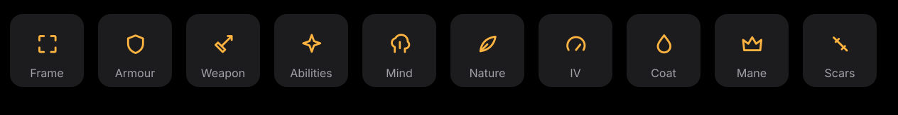
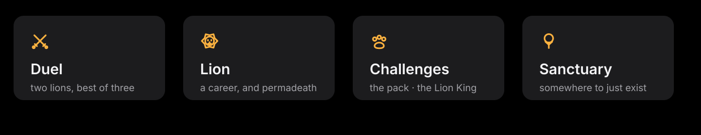

<p align="center">
  
</p>

<p align="center">
  
  
  
</p>

---

## You don't control the lion

You build it. Then you watch.

Lion Sim is an arena fighting game where the lions fight on their own. You pick the frame, the weapon, the abilities and the mind. Once the gate opens, it's all them. They chase, kite, dodge and hit their big moves when it counts, and they win or lose on their own.

You're the owner, not the player.

**Download `lion-simulator.html` and open it in any browser.** That's it. It works on your phone too, and you can add it to your home screen.

---

## Build a lion

<p align="center">
  
</p>

- **Frame.** Tiny cubs are fast and fragile. Titans are slow and hit like a truck.
- **Weapon.** 14 of them, from claws and spears to bows, fireballs and a Sunbeam. Long reach slows you down.
- **Abilities.** Pick two: dash, blink, roar, heal, shield, frenzy, go invisible, call a cub, and more.
- **Mind.** Berserker, Duelist, Kiter, Trickster or Adaptive. It changes how the lion fights, not how hard it hits.
- **Personality.** Every lion carries two of 23 traits. *Grudge* gets angrier with every scar. *Showman* fights better when the crowd is loud. *Lucky* cheats death more often.
- **Looks.** 12 coats, 8 manes, 8 tails. Pure style.

Hit **Roll** anywhere to get a random lion in one tap.

---

## Modes

<p align="center">
  
</p>

### ⚔️ Duel
Two lions, best of three. Build both, roll both, or paste in a friend's lion and settle it.

Switch to **2v2** for tag-team fights: two teams of two, and a round only ends when both lions on one side are down. Teammates never hit each other.

### 🏆 Championship
Build your own lion and send it through five-fight championships. Win all five and it earns a **gold belt** and a medallion that makes it stronger. Once it's yours, it's locked in. No tweaks.

Losing hurts. Every loss it survives leaves a **scar** you'll see on it forever. And every time it loses, there's a **1 in 5 chance it dies**. Then it goes up on the Hall of Fame and you start again. Fallen and retired lions aren't lost: tap any of them on the wall to see the lion, its card, its full summary and its code, so you can bring it back in a duel.

Every opponent has a fight record of its own. Your first ones are rookies like you, sitting on records like 1–0 or 2–3. The deeper you go, the more fights they've had and the more they've won. Win a belt and the last opponent of every championship after that is a belt holder too.

Lions **remember you**. One that beats you and lets you live becomes a **rival**, and so might one you only just scraped past. Rivals come back in later championships, a little harder each time, and the den keeps the score between you. A lion that **kills** yours becomes your **nemesis**: it outlives your lion and comes back for the next one, as the final, with red eyes and a mark for every lion it's taken. Beat it and it's **avenged** (40 gold and 3 skulls).

Every win also has a **35% chance of a training opportunity**: pick health, damage, speed, swing or armour and your lion gets a little better at it, for good. Belts bring **medallions**, bigger boosts with their own emblems. You can also **load any lion code** straight into the den.

Your lion's gold and skulls sit at the top of the screen (tap them to go straight to the shops), and the den shows who's next at a glance. Every win earns your lion **gold**, and so does every wave of the pack it survives. Spend it in the **Lion Store**, run by a red lion in a gold monocle: a new coat, a potion that rerolls one personality trait, a whole new weapon, an **Upgrade Token** (100 gold) for a guaranteed training session, or a **Name Plaque** (60 gold) to rename it.

Next door, the **Blacksmith** (an old grey lion covered in soot) puts a finish on your lion's weapon: **Bronze, Obsidian, then Gilded** (50, 150 and 250 gold), each worth +2% damage and a glint of its colour on every swing and shot. The finish belongs to the weapon, so swap weapons and it's gone (you'll get a warning first). He also sells **Reforge Armour** (50 gold) to change armour.

Under the stands, the **Hyena Fence** buys skulls (1 skull → 25 gold), sells **Mystery Crates** (45 gold: gold, skulls, anything from any shop, and once in a while a soul), and keeps three under-the-counter **deals**, 5 to 10 gold off, that change after every bout. Whatever you buy goes into the lion's own **inventory**, and you use it from there whenever you like. Beat a lion in a championship and there's a 30% chance your lion takes its **skull** home. Skulls stack, and they're the only thing the **Mystic Lion** next door will take: 7 skulls buys a **Divine Soul** (eyes that glow white like an angel's and a holy light around it) or a **Demonic Soul** (red eyes and hellfire). Either one gives +10% to every stat. A lion can only carry one soul at a time. **Soul Cleanse** (2 skulls) washes a soul away, and a **Blood Pact** (5 skulls) rerolls your lion's IV, for better or worse. For 3 skulls it also sells **Heavenly Protection**: if your lion would die in a championship, the blessing burns away instead and it walks out alive. The gold and the bag belong to that lion. When it's gone, so are they.

**The Bookie.** A green lion in a flat cap and a pencil behind his ear runs fights between two other lions. You get a look at both (record, frame, weapon, mind and how big they are) and his odds on the chalkboard, back one, and watch it play out. Win and you get your stake times the odds; lose and he keeps it. Bigger lions are usually the favourites, and the odds lean very slightly your way, so it's a way to make money, slowly: he only runs **three fights between each of your championship bouts**, and stakes are capped at 25 gold (+15 per belt, up to 100). You can also watch for free. Your lion keeps a tally of how its betting is going.

**Events.** After a win, with another bout still to come, there's a **20% chance something happens** outside the den. The den shows it, the bottom button turns into **An event awaits**, and you can't fight on until you've gone and seen it. Each one plays out as a little scene with a choice:
- **The Royal Lion.** A big grey lion with a curly mane, a crown and a red sash walks in with two guards in plate. He liked your last fight and wants a bet on the next one: win and he **doubles your gold**, lose and he **takes all of it**.
- **The Mystic Lion**, by a campfire in the dark, offers **two skulls** now if your lion starts its next bout on **75% health**.
- **The Lion Store owner** comes round the counter himself: he wants your lion as the face of his shop. Sign, and everything in the Lion Store is **30% off for your next 5 bouts** (prices show the discount, and the den counts the bouts down).
- **The crate in the trees.** A crate in a forest clearing, nobody around. Open it and you get a **free random item**, then **five hyenas** come out of the bushes. Beat them and it's yours; lose and they take it back (they never kill your lion, and it's not on its record). Walk away and nothing happens.

Say no to any of them and nothing changes. The wager, the Mystic's price and the mascot deal show in the den until they're settled.

### 🐾 Challenges
**The pack.** Survive wave after wave of dogs and hyenas.
**The Lion King.** One fight against a giant in black armour with red eyes.
**The Ancient Lion.** A navy-and-gold colossus, half as big again as a titan. Get close and it blasts you with a gold nova. Stay back and it drops stars on you.
**Old Lion.** Your tutor, out of retirement for one last fight. Beat him if you can... and if you can live with it.

Boss fights are long, grand affairs: the bosses carry huge health bars and hit softer, so a win over the King or the Ancient Lion takes two minutes or more (Old Lion is still the easy one, about a minute), and at two-thirds and one-third health each one has a moment ("THE KING IS BLEEDING"). Bring up to two friends to any of them.

### 🥇 Tournament
Eight lions, one bracket. Quarter-finals, semis, final, and every match is best of three. Edit any lion, roll them all, shuffle the draw and watch one come out on top.

---

## Lion codes

Every lion fits into one line of text:

```
LION1-R29sZG1hbmV8NHwyfDN8MTEuNXwzfDAuMnwyLjExLjE0fDF8N3wxfDEyODQuNjE3fDEyLjE4
```

Copy it, save it as a `.txt`, send it to a mate. It carries everything: the build, the looks, the scars and the belts. Paste a champion into a duel and the game asks whether it keeps its medallions or comes in fresh.

Belts can only be won. The Editor always loads lions without them.

---

## Little things

- Every fight opens at the gates. The portcullis lifts, each lion walks out to its mark and its name and record are called out in its own colours. Tap to skip.
- Every weapon looks like what it is: claws rake, spears thrust, arrows fly fletched, boulders tumble and crack the floor, fireballs leave scorch marks, venom pools, Storm Bolt forks and the Sunbeam burns.
- A crowd of lions fills the stands and reacts to every big hit.
- An original soundtrack, all generated live: a brooding pre-battle theme while your lion waits at the gate, war drums in the fights, something heavier for the bosses... and one very sad song. The ⋯ menu at the top cycles sound + music, sound only, or off.
- Every lion is drawn live, so scars, belts, manes and tails show up everywhere, including in the fights.
- Open any lion's **Summary** to get its **lion card**: a trading-card picture with the lion, its badges, traits, stats, loadout and record. Copy it, save it or share it straight to your friends.
- Every mode lives in the bar along the bottom, with a free **Editor** at the end for building anything you want, just for fun.
- New here? Tap **?** and Old Lion will walk you through everything. He's been around a while.
- Your progress saves in the browser, so your lion, gold and tournament are still there next time.

---

<p align="center">
  
</p>

<p align="center">
  <sub>There is one name you should not give a lion.</sub>
</p>
